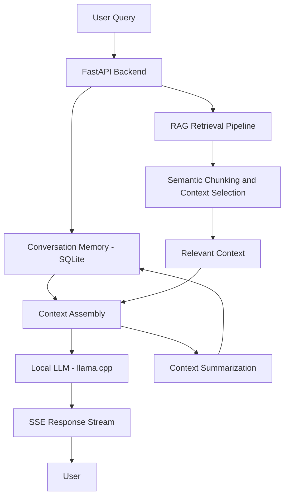

# Autumn — Local AI Chatbot with Advanced RAG

**A privacy-focused, low-latency AI chatbot powered by local LLM inference and Retrieval-Augmented Generation (RAG).**

Autumn is a locally running AI chatbot built to deliver contextual, multi-turn conversations without depending on external LLM APIs. It combines local language model inference, semantic document chunking, context-aware retrieval, and persistent conversation memory to generate relevant responses while keeping inference and application data under your control.

[](https://www.python.org/)
[](https://fastapi.tiangolo.com/)
[](https://www.sqlite.org/)
[](https://github.com/abetlen/llama-cpp-python)

## Table of Contents

- [Overview](#overview)
- [Key Features](#key-features)
- [System Architecture](#system-architecture)
- [RAG Pipeline](#rag-pipeline)
- [Technology Stack](#technology-stack)
- [Performance](#performance)
- [Getting Started](#getting-started)
- [API Documentation](#api-documentation)
- [Privacy and Security](#privacy-and-security)
- [Future Improvements](#future-improvements)
- [Contributing](#contributing)
- [License](#license)

## Overview

Traditional AI chat applications often rely on external inference APIs, introduce recurring usage costs, and send user prompts to third-party services.

Autumn explores an alternative: a local-first AI architecture that combines language model inference with retrieval, conversational memory, and backend optimizations.

The project focuses on three core engineering challenges:

- **Contextual accuracy:** Improving response relevance through semantic chunking and context-aware retrieval.
- **Low-latency inference:** Running quantized language models locally through `llama-cpp-python` and streaming generated output.
- **Conversation continuity:** Maintaining multi-turn context using SQLite-backed memory and context summarization.

The result is a modular foundation for building private, locally operated AI assistants.

## Key Features

### Advanced Retrieval-Augmented Generation

- Semantic chunking to organize source documents into meaningful segments.
- Context-aware retrieval to supply relevant information to the language model.
- Retrieval-grounded generation to improve contextual relevance and reduce reliance on unsupported responses.

### Local LLM Inference

- Runs supported local language models through `llama-cpp-python`.
- Avoids external LLM inference APIs during local inference.
- Supports quantized GGUF models compatible with the selected runtime and hardware.

### Real-Time Response Streaming

- Uses Server-Sent Events (SSE) to stream generated output incrementally.
- Reduces perceived response latency by allowing users to receive tokens before generation finishes.

### Persistent Conversational Memory

- Uses SQLite to persist conversation-related data.
- Supports multi-turn interactions by retaining relevant conversational context.
- Applies context summarization to help manage long conversations and reduce prompt token usage.

### Backend Optimization

- Database caching to reduce repeated database work where applicable.
- Context management to limit unnecessary prompt growth.
- A FastAPI backend for exposing and integrating chatbot functionality.

## System Architecture



The architecture separates request handling, retrieval, memory management, and model inference so that each component can be developed and optimized independently.

## RAG Pipeline

Autumn uses a retrieval-augmented generation workflow to provide the language model with relevant contextual information.

1. **Query processing:** Receive the user's query through the backend.
2. **Context retrieval:** Identify relevant source information using the retrieval pipeline.
3. **Semantic chunking:** Organize source content into meaningful chunks to preserve contextual relationships.
4. **Context assembly:** Combine the retrieved information with relevant conversation history.
5. **Local inference:** Pass the assembled prompt to the local language model.
6. **Streaming generation:** Return generated output incrementally using SSE.
7. **Memory persistence:** Store relevant conversation data in SQLite and summarize older context when appropriate.

```text
User Query
    |
    v
Query Processing
    |
    v
Context Retrieval
    |
    v
Semantic Chunking / Context Selection
    |
    v
Conversation Context Assembly
    |
    v
Local LLM Inference
    |
    v
SSE Token Streaming
    |
    v
Persistent Conversation Memory
```

*Note: The exact retrieval algorithm, embedding model, and vector-store implementation depend on the configured project implementation.*

## Technology Stack

| Technology | Purpose |
|---|---|
| Python | Core application and AI logic |
| FastAPI | Backend API and request handling |
| llama-cpp-python | Local LLM inference |
| GGUF-compatible models | Local language generation |
| SQLite | Persistent conversation memory |
| Server-Sent Events | Incremental response streaming |
| RAG | Context-grounded response generation |
| Semantic chunking | Meaningful document segmentation |
| Caching and summarization | Backend and context optimization |

## Performance

The project's reported performance figures are:

| Metric | Reported Result |
|---|---:|
| Time to first token (TTFT) | 110–130 ms |
| Generation throughput | 9+ tokens/second |

These figures describe reported project measurements, not guaranteed performance. Actual results depend on the model, quantization, hardware, prompt length, context size, and measurement methodology.

For meaningful benchmarking, evaluate TTFT and generation throughput separately across representative prompts and document the hardware and model configuration.

## Getting Started

### Prerequisites

- Python 3.10 or a version supported by the project's dependencies.
- Git.
- A compatible local language model in GGUF format.
- Hardware with sufficient memory for the selected model and context size.

### 1. Clone the Repository

```bash
git clone https://github.com/bhavyaupreti05/AUTUMN.git
cd AUTUMN
```

### 2. Create a Virtual Environment

**Windows — PowerShell**

```powershell
python -m venv .venv
.\.venv\Scripts\Activate.ps1
```

**Linux / macOS**

```bash
python3 -m venv .venv
source .venv/bin/activate
```

### 3. Install Dependencies

If the repository contains a `requirements.txt` file:

```bash
python -m pip install --upgrade pip
pip install -r requirements.txt
```

If `llama-cpp-python` requires a particular build configuration for your hardware, follow its official installation instructions.

### 4. Configure the Local Model

Download a compatible GGUF model and configure the model path using the configuration mechanism supported by the project.

For example, if the application supports environment-based configuration:

```env
MODEL_PATH=path/to/your-model.gguf
```

Use the actual environment variable names and configuration format defined in the repository. Do not commit model weights, credentials, or private conversation data to Git.

### 5. Start the Application

Run the FastAPI application using the entry point defined in the project. For example, if the entry point is `main.py` and the FastAPI instance is named `app`:

```bash
uvicorn main:app --reload
```

Replace `main:app` with the actual module and application variable if they differ.

## API Documentation

Autumn uses FastAPI for backend integration.

Once the server is running, open:

- **Swagger UI:** `http://127.0.0.1:8000/docs`
- **ReDoc:** `http://127.0.0.1:8000/redoc`

These documentation pages expose the routes registered by the application and allow supported requests to be tested interactively.

The actual chat endpoint, request schema, and streaming response format should be taken from the current implementation.

## Privacy and Security

Autumn is designed around local inference and user-controlled data.

- **Local inference:** Prompts can be processed by a locally hosted model without sending them to an external LLM inference API.
- **Local persistence:** SQLite can retain conversation data on the host machine.
- **Reduced external dependency:** Core inference does not require a hosted LLM API when configured for local operation.

Local inference alone does not guarantee complete privacy. Network exposure, application logs, database access, downloaded model sources, and any optional external integrations should also be reviewed.

## Future Improvements

Potential areas for further development include:

- Hybrid retrieval combining keyword and semantic search.
- Reranking retrieved chunks to improve context relevance.
- Evaluation datasets for retrieval quality and answer groundedness.
- Automated benchmarking for TTFT, throughput, and memory consumption.
- Improved conversation-memory policies and configurable context windows.
- Authentication, access controls, and production deployment hardening.
- A polished chat interface with conversation history and streaming responses.

## Contributing

Contributions, bug reports, and suggestions are welcome.

1. Fork the repository.
2. Create a feature branch.
3. Implement and test your changes.
4. Open a pull request describing the changes and their motivation.

## License

A license has not been specified here. Add a `LICENSE` file and update this section to reflect the license selected for the project.

---

**Built with Python, FastAPI, SQLite, and local LLM inference.**

[Explore the Autumn repository](https://github.com/bhavyaupreti05/AUTUMN)
