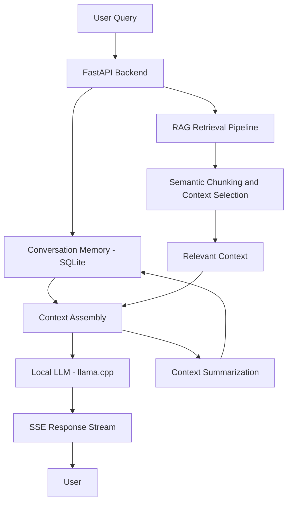

# Autumn — Local AI Chatbot with Advanced RAG

**A privacy-focused, low-latency AI chatbot powered by local LLM inference and Retrieval-Augmented Generation (RAG).**

Autumn is an intelligent, privacy-focused conversational AI platform powered by **Qwen2.5 3B Instruct (GGUF)** and augmented with local **Retrieval-Augmented Generation (RAG)** using ChromaDB and PyMuPDF.

[](https://www.python.org/)
[](https://fastapi.tiangolo.com/)
[](https://react.dev/)
[](https://www.sqlite.org/)
[](https://github.com/abetlen/llama-cpp-python)

---

## 🔑 Default Credentials

When first deployed, the database automatically seeds the initial administrator account:

| Role | Username / Email | Password |
|------|------------------|----------|
| **Admin** | `bhavya05@mail.com` | `12345` |
| **User** | `testuser@autumn.ai` | `12345` |

*(You can change your password anytime in the user settings or admin dashboard.)*

---

## Table of Contents

- [Overview](#overview)
- [Key Features](#key-features)
- [System Architecture](#system-architecture)
- [RAG Pipeline](#rag-pipeline)
- [Technology Stack](#technology-stack)
- [Performance](#performance)
- [Deployment with Docker & Hugging Face Spaces](#deployment-with-docker--hugging-face-spaces)
- [Getting Started Locally](#getting-started-locally)
- [API Documentation](#api-documentation)
- [Privacy and Security](#privacy-and-security)

---

## Overview

Traditional AI chat applications often rely on external inference APIs, introduce recurring usage costs, and send user prompts to third-party services.

Autumn provides a local-first AI architecture that combines language model inference with retrieval, conversational memory, and backend optimizations.

The project focuses on three core engineering challenges:

- **Contextual accuracy:** Improving response relevance through semantic chunking and context-aware retrieval.
- **Low-latency inference:** Running quantized language models locally through `llama-cpp-python` and streaming generated output.
- **Conversation continuity:** Maintaining multi-turn context using SQLite-backed memory and context summarization.

---

## Key Features

### Advanced Retrieval-Augmented Generation
- Semantic chunking to organize source documents into meaningful segments.
- Context-aware retrieval to supply relevant information to the language model.
- Retrieval-grounded generation to improve contextual relevance and reduce reliance on unsupported responses.

### Local LLM Inference
- Runs supported local language models through `llama-cpp-python`.
- Avoids external LLM inference APIs during local inference.
- Supports quantized GGUF models compatible with the selected runtime and hardware.

### Custom Chatbots & External Widget
- Create specialized AI assistants with custom system prompts and document subsets.
- Embed any custom chatbot into external websites with a single `<script>` tag.

### Real-Time Response Streaming
- Uses Server-Sent Events (SSE) to stream generated output incrementally.
- Reduces perceived response latency by allowing users to receive tokens before generation finishes.

### Persistent Conversational Memory
- Uses SQLite to persist conversation-related data.
- Supports multi-turn interactions by retaining relevant conversational context.
- Applies context summarization to help manage long conversations and reduce prompt token usage.

---

## System Architecture



---

## Technology Stack

| Component | Technology | Purpose |
|---|---|---|
| **Frontend** | React 18, TypeScript, Tailwind CSS, Vite | Responsive, modern Single Page Application |
| **Backend API** | FastAPI, Uvicorn (Single Worker) | Core application, authentication, and request handling |
| **LLM Inference** | llama-cpp-python | Local GGUF CPU inference engine |
| **Model** | Qwen2.5 3B Instruct (Q4_K_M) | Fast, efficient conversational intelligence |
| **Database** | SQLite (WAL mode, connection pooling) | Persistent conversation memory & user management |
| **Vector DB** | ChromaDB | Embedding storage for RAG document retrieval |
| **Streaming** | Server-Sent Events (SSE) | Incremental real-time response streaming |

---

## Deployment with Docker & Hugging Face Spaces

### Deploying to Hugging Face Spaces (Free 16GB RAM)

1. Create a new Space on [Hugging Face](https://huggingface.co/new-space).
2. Set **Space Name** (e.g. `autumn`) and select **Docker** as the Space SDK.
3. Push this repository to your Space repository:
   ```bash
   git remote add hf https://huggingface.co/spaces/<YOUR_HF_USERNAME>/autumn
   git push hf main
   ```
4. Hugging Face Spaces will automatically build the container using the provided `Dockerfile` and launch Autumn on port `7860`.

### Running Locally with Docker

```bash
docker build -t autumn .
docker run -p 7860:7860 autumn
```

Then open `http://localhost:7860` in your browser.

---

## Getting Started Locally

### 1. Prerequisites
- Python 3.12+
- Node.js 18+
- Compatible GGUF model (`qwen2.5-3b-instruct-q4_k_m.gguf`)

### 2. Setup Backend
```bash
python -m venv venv
# On Windows:
.\venv\Scripts\Activate.ps1
# On Linux/macOS:
source venv/bin/activate

pip install -r requirements.txt
python -m uvicorn src.api.main:app --host 127.0.0.1 --port 8000
```

### 3. Setup Frontend
```bash
cd client
npm install
npm run dev
```

---

## API Documentation

Once the server is running, interactive API docs are available at:

- **Swagger UI:** `http://localhost:8000/docs`
- **ReDoc:** `http://localhost:8000/redoc`

---

## Privacy and Security

- **Zero External API Calls**: All inference and embeddings run fully locally or inside your private container.
- **Strict Single-Worker Concurrency**: Eliminates CPU resource contention and rate-limiting bypass.
- **Enterprise Auth & Admin Panel**: Secure bcrypt-hashed passwords and JWT tokens with automatic session invalidation on reset.

---

[Explore the Autumn repository](https://github.com/bhavyaupreti05/AUTUMN)
